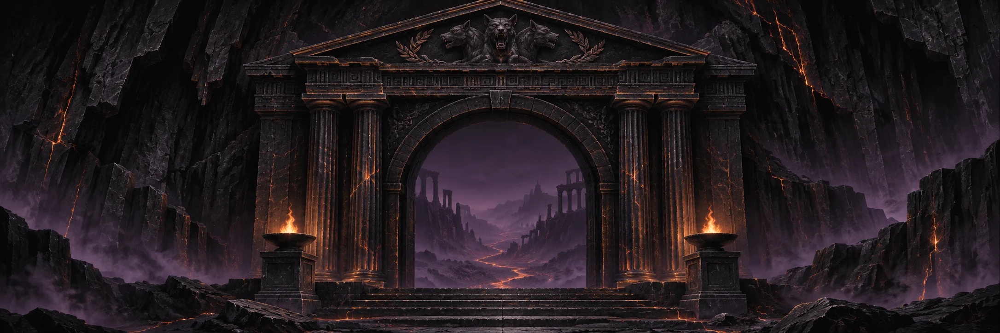
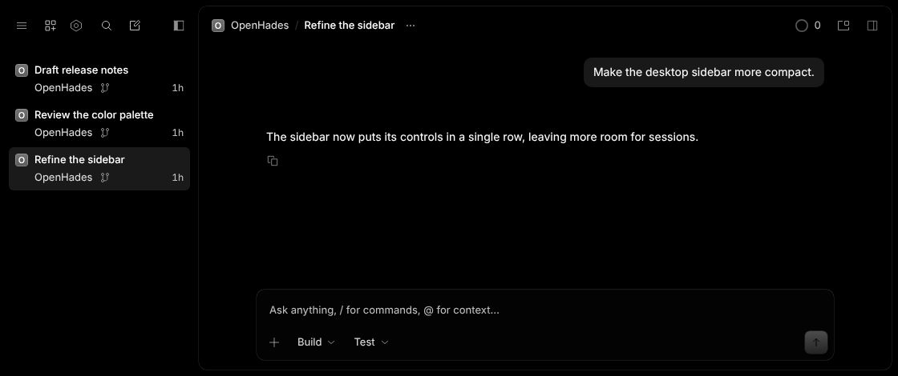

<p align="center">
  
</p>

# OpenHades

OpenHades is an OpenCode fork with a near-black AMOLED theme and a compact desktop sidebar. On Linux, Menu, Home, Settings, Search, and New Session share one row of icons.



## Run from source

Use Node.js 24 and the Bun version listed in [`package.json`](../package.json).

```bash
git clone --branch openhades --single-branch https://github.com/silasthegoldenwizard/opencode.git openhades
cd openhades
bun install --frozen-lockfile
bun run dev:desktop
```

In **Settings → Appearance**, choose **hades** and select the **Dark** color scheme. In **Settings → Preferences → Interface layout**, select **Side tabs** or **Inbox** to see the compact sidebar.

## Upstream

OpenHades builds on [OpenCode](https://github.com/anomalyco/opencode) and retains its [MIT license](../LICENSE). The `dev` branch follows OpenCode upstream. The `openhades` branch carries the Hades theme and layout.
